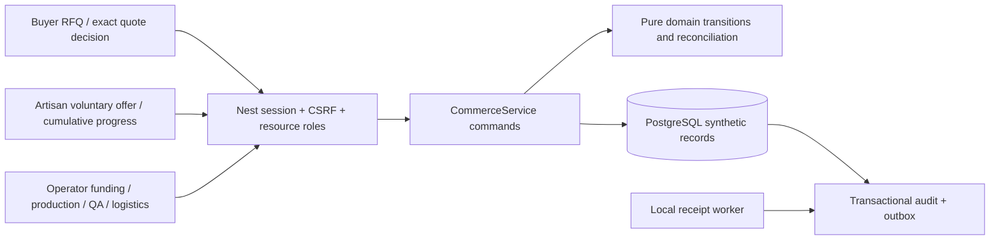

# Synthetic commerce: domain rules and implemented boundaries

This bounded implementation completes the domain and critical-journey scope of #32/#88. All commercial rows have immutable `SYNTHETIC` provenance, enforced by PostgreSQL CHECK constraints. Settlement evidence is always `SIMULATED_SETTLEMENT`. There is no banking adapter, real contract execution, monitoring upload, verified-hardware claim or assertion that simulated receipts are real money.

The states below come from sections 3–5 of the product's `NASJ_FINAL_Detailed_Backlog.md`, inspected in the optional sibling docs checkout. The original requirements for #32/#88/#195 are preserved in `../engineering/issues/`. The implemented transitions live in `packages/contracts/src/commerce/domain.ts`, independently of Prisma/Nest/React. Strict wire contracts and safe projection types live in `commerce/contracts.ts`. Nest's `CommerceService` invokes these rules within the existing serialized IAM transaction; state, command outcome, audit and metadata-only outbox commit atomically.



| Entity | Supported normal path | Role / guarded branches |
|---|---|---|
| RFQ | DRAFT → SUBMITTED → UNDER_REVIEW → QUOTED → ACCEPTED | Buyer drafts/submits/accepts/declines; production reviews; finance quotes/expires. Drafts are private. Accepted quote creates one order. Quote must be current and unexpired. |
| Offer | PLANNED → OFFERED → ACCEPTED | Production creates immutable offered terms/reservation; only the owner artisan accepts/declines. Expiry releases tentative capacity. Decline causes no eligibility penalty. |
| Order | APPROVED → FUNDING_CONFIRMED → PLANNING → IN_PRODUCTION → QUALITY_REVIEW → READY_TO_SHIP → IN_TRANSIT → DELIVERED → BUYER_ACCEPTED → SETTLED → CLOSED | Funding/settlement/closure require finance; planning/release production; shipment approval QA; shipment/delivery logistics; receipt acceptance buyer. |
| Batch | ACCEPTED → MATERIAL_READY → IN_PROGRESS → SUBMITTED → INSPECTION → APPROVED → COMPLETED | Material readiness/completion production; progress/submission artisan; inspection/QA inspector. INSPECTION → REWORK_REQUESTED → IN_PROGRESS requires explicit owner rework acceptance. Rework may be disputed. |
| Synthetic payment | SCHEDULED → APPROVED → INITIATED → SETTLED | Finance only; scheduled/approved can be cancelled, initiated can fail/be disputed. Settled is terminal and requires explicitly simulated evidence. Buyer receipt and artisan payout are separate kinds. |

Every unlisted edge, same-state duplicate with a new command key, forbidden role or terminal-state mutation is rejected. The source's `AMENDED` order state is recognized but has no enabled edge: contract amendment/reapproval needs its own reviewed workflow and cannot be reached through a status toggle. Controlled cancellation is restricted to an unstarted APPROVED order without accepted/reserved work, receipts, artisan obligations or pending payments. Disputed order/batch/payment branches preserve history and block settlement/closure; no automatic dispute resolution or write-off exists.

## Exact money and quantities

TND uses bigint millimes throughout commands and PostgreSQL BIGINT; 1 TND = 1000 millimes. Decimal API/UI strings have at most three digits on input and exactly three on output. Existing `parseTnd`, `formatTnd`, `addTnd`, `prorateTnd` reject precision loss, negatives and overflow beyond 9223372036854775807 millimes. Proration uses HALF_UP once at the millime boundary. Offer pay and payouts use integer `unitPayMillimes × wholeUnits`; no floating-point totals occur. Buyer quote totals never leak through artisan projections.

Whole piece quantities are safe integers 0..1,000,000; requested/offer quantities must be positive. Capacity remains an independently consented decimal declaration, never sensor-derived. A piece declaration covering the delivery date is selected explicitly; reservations and accepted commitments across all orders referencing that declaration cannot exceed its quantity. Future declared windows can be planned. This conservative prototype reserves against a selected period without multiplying weekly capacity by period length; calendar optimization/capacity amendments are separate work.

For an order:

```text
reserved + allocated <= requested
produced <= allocated
submitted <= produced
approved + rejected + pending = submitted
delivered <= approved
```

`reserved` includes unexpired PLANNED/OFFERED quantities; `allocated` includes explicitly ACCEPTED offers. Decline/expiry frees only tentative reservations. Production reports are **cumulative**: previous <= new <= accepted quantity. Each submission establishes pending QA counts; produced and QA-approved remain distinct. Inspection attempts are immutable, versioned snapshots. Approved quantities never decrease; reinspection replaces the current reconciliation while preserving previous attempts, preventing repeated counting. Each batch has exactly one accepted offer.

Artisan eligible obligation is derived independently of buyer receipt timing: QA-approved units × immutable accepted unit pay under the displayed synthetic milestone policy. Multiple partial payment records are allowed, but settled + outstanding scheduled/approved/initiated/disputed reservations + a new amount cannot exceed eligible value. Failed/cancelled payment records preserve history without reserving more funds. Buyer receipts reconcile against the accepted quote; payouts reconcile against the selected batch, whose parent order is checked server-side.

Shipment requires the full requested quantity to be QA-approved with no rejected/pending units. Settlement requires full delivered/buyer-accepted quantity, exact buyer receipts, every artisan obligation covered and no disputes or pending payments. Closure additionally records an explicit synthetic material/returns disposition note. That note is an operator attestation, not a physical inventory measurement. Partial-fulfillment contract remedies, amended pricing, real accounting/tax and evidence-backed bank settlement are outside this prototype; conservative guards reject paths that would hide obligations.

## Authorization, replay and persistence

Roles come from current approved organization memberships. Buyer access requires BUYER in the owning buyer organization. Operator permissions require the actual PRODUCTION_MANAGER / QUALITY_INSPECTOR / FINANCE_MANAGER / INVENTORY_LOGISTICS_COORDINATOR role in the assigned INTERNAL organization. Manager/global ADMIN alone grants none of these operations. Artisan decisions/progress require the profile owner; association coordinators cannot accept on their behalf. Acceptance also requires current profile-processing consent. New offers require active skill, consent, usable capacity and active verified artisan account.

All commerce mutations require a bounded `Idempotency-Key`. Scope binds actor, resolved resource, operation and canonical validated payload. Replay rechecks current ownership/membership/role before returning the original `{id,version}` result. Required input `version` rejects stale writes; identical committed requests with the same key replay even though the record has advanced. Keys, outcomes and snapshots remain private; no automatic ledger expiry is configured. Browser retries keep the key while the same mounted form retries identical input; page reload loses that transient browser key.

Additive migration `202610200002_synthetic_commerce` creates six related tables with foreign keys, unique order-per-RFQ/batch-per-offer/inspection-version constraints, state/provenance/money/count checks. No existing record is rewritten. API errors use safe 400 validation, 403 denied role/consent, 404 missing record and 409 transition/version/reconciliation conflicts. Events contain metadata only; free-text specifications, terms, QA reasons, amounts and wearable values are not copied to the outbox.
