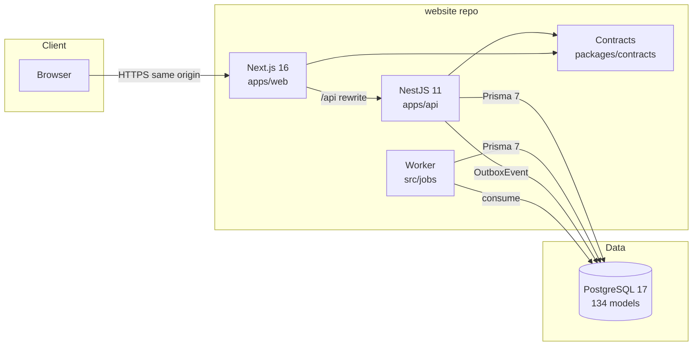

# Component diagram

**Last verified:** 1 November 2026.

No component in this diagram crosses a repository boundary. The AI backend and IoT simulator are
separate processes with no runtime link to the website.

## Related

- [System overview](system-overview.md)
- [Data flow](data-flow.md)
