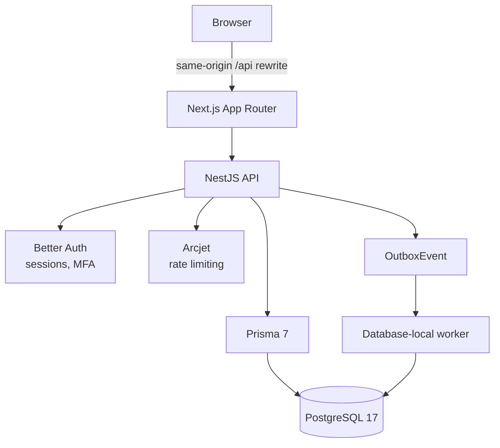

# System overview

**Last verified:** 1 November 2026 against commit `70a3900`.

The architecture is deliberately small: one frontend, one API, one database. Authorization,
transaction integrity and audit live in the API, never in the client.

## Components

| Component | Responsibility | Location |
|---|---|---|
| Next.js frontend | Rendering, forms, same-origin API rewrite | `apps/web/` |
| NestJS API | Authentication, authorization, business rules, transactions | `apps/api/src/` |
| Shared contracts | Strict Zod request schemas, safe response types | `packages/contracts/src/` |
| PostgreSQL | System of record | 134 Prisma models, 39 migrations |
| Worker | Consumes metadata events, rebuilds projections | `apps/api/src/jobs/` |

## Request path

1. The browser calls `/api/v1/...` on the same origin.
2. Next rewrites that to the API's internal origin (`API_INTERNAL_URL`).
3. Nest authenticates the session, checks CSRF for mutations, applies the role/permission check, and
   validates the body against a shared Zod schema.
4. The service runs inside an IAM transaction that takes global advisory locks.
5. State, audit event and outbox event commit atomically.

There is no Redis, no message broker and no second database.

## Modules

19 business modules under `apps/api/src/modules/`:

`artisans`, `auth`, `catalog`, `collaboration`, `commerce`, `demo`, `directory`, `finance`,
`foundation`, `governance`, `health`, `intelligence`, `inventory`, `mail`, `organizations`,
`procurement`, `registry`, `sales`, `users`.

15 controllers expose 321 routes under `/api/v1`, plus `/api/health`.

## Boundaries that matter

- **Client never grants access.** Hidden buttons and frontend roles are cosmetic; the API re-checks
  every request.
- **One transaction per command.** Business state, audit and outbox commit together or not at all.
- **Synthetic by construction.** The database constrains financial and delivery records to
  `SYNTHETIC` provenance, so a real payment or shipment cannot be recorded by accident.

## Related

- [Component diagram](component-diagram.md)
- [Authorization model](authorization-model.md)
- [Database architecture](database-architecture.md)
- [Transaction integrity](transaction-integrity.md)
- [API architecture](api-architecture.md)
