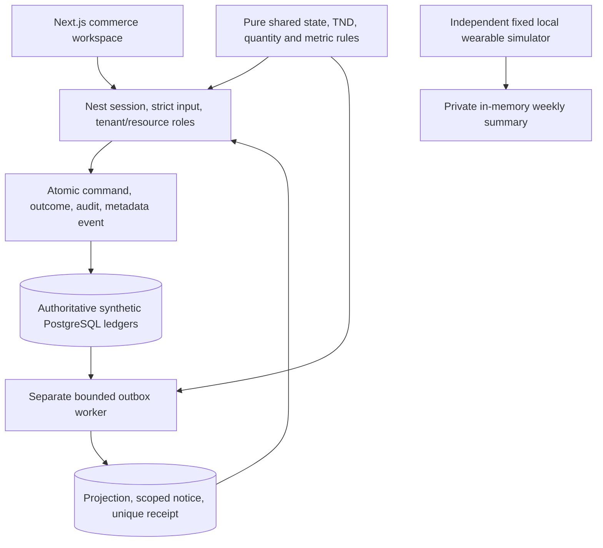

# E16 full-epic engineering report — 2026-10-20

Simulator ownership update: the user requested IoT ownership after this verification run. The simulator now lives in the independent `iot/simulator` project with its own tools/lockfile/tests/CI. Website commands no longer build/test/run it, and the cross-repository simulator integration scenario was removed. Current website totals are 46 unit and 58 integration tests; IoT separately retains 12 simulator tests. Earlier 54/59 logs below are historical pre-move evidence. Device/application communication remains deferred.

## Executive outcome

The existing Next/Nest/Prisma foundation and completed synthetic commerce domain/UI were extended incrementally. The receipt-only worker now performs useful durable in-app delivery and rebuildable analytics; scoped reports/CSV/inbox are connected to the commerce UI. An independent fixed wearable simulator implements the user-approved interim approach. Actual authenticated encrypted backup/restore, private storage/retention, backup-age alerts and logger redaction are tested. No broker, runtime IoT integration, live transfer, new external dependency or replacement authentication system was introduced.

Eleven stories meet the implemented synthetic/local-demo scope, including #30 fresh-source verification. #197 has completed simulator/matrix deliverables but retains physical-device verification until the device arrives. This is not a claim that the complete epic or production release is unconditionally finished. Each original criterion and limitation is mapped in [acceptance](e16-acceptance-matrix.md). Hardware is deferred explicitly by the user, not simulated as measured evidence.

## Changes and story evidence

| Stories | Actual result and source locations |
|---|---|
| #32, #75 | Five pure guarded domain machines, exact TND and quantity/settlement authority remain transactional and replay-safe. All critical implemented commerce mutations use durable scoped outcomes; new analytics do not write those ledgers. `packages/contracts/src/commerce`, API commerce service, domain/scenario tests. |
| #78, #79 | Reports and downloads recheck current resource roles/tenant memberships; buyer/QA finance minimization, foreign-tenant/nested/owner denial and revocation tested. Inbox scopes cannot be overridden by clients. Commerce controller/service and integration scenarios. |
| #76, #196 | `jobs/commerce-consumer.ts` derives version-1 projections from synthetic authoritative records and shipment/acceptance audits, creates static scoped notices and receipt atomically. Existing outbox bounds retries/batches and exposes failure/duration/lag. Trusted `--rebuild-analytics` safely backfills without ledger/notification changes. Actual failure-after-effects, concurrent replay and SIGKILL/restart tests. |
| #194, #88 | 58 seeded PostgreSQL/SMTP scenarios and 15 Chromium cases; three full commerce journeys through payout/closure, reports, downloads and notifications at 360/768/1280px. Keyboard/focus/reduced-motion and 15 axe checkpoints; mobile CPU/network emulated. Existing identity/MFA/delegation/browser failure tests retained. |
| #77 | AES-256-GCM backup CLI, owned private key/storage, no overwrite/symlinks, seven-day pruning, age alerts, actual Pino sentinel test, five-second DB acquisition timeout. User approved local owner/24h RPO/4h RTO/7d retention. Actual CLI dump/decrypt/restore compares all 33 table counts/hashes, including commercial ledgers. |
| #197 | `iot/simulator` has no network/database/commerce runtime dependency; fixed configurable inputs with replaceable device/motor adapters. Twelve tests cover threshold/rest/reset/cooldown/invalid/disconnect/motor/local-summary/deletion/non-upload. Separate-process integration proves capacity/commerce/outbox unchanged. Physical board/IMU/wiring/storage/network capture remain pending. |
| #30, #195 | Existing pinned toolchain/build ordering preserved; independent IoT simulator project and additive projection/notice migration. All local quality gates now pass, including ordinary frozen installation and the full fresh-source pipeline; both website and IoT audits report no known vulnerabilities. The published source commits are website da170ab and IoT f471b2b; hosted workflow results are linked in the test report. Actual guides and exact limitations updated. |

## Architecture and contracts

No arrow connects personal wearable data to commerce. The worker reuses existing durable events rather than introducing a separate broker. API and workers share a fixed lock order for consistent prototype snapshots; throughput at commercial growth scale is not claimed. Local effects are atomic and deduplicated under at-least-once execution. Invitation/support SMTP remains a separate existing integration and is not called in a consumer transaction.

Derived reports carry SYNTHETIC/SIMULATED provenance, registry version, UTC order-lifetime period, asOf and pending/stale status. Produced, submitted, approved, shipped, received and accepted quantities retain requested denominators; zero denominator produces null rate. Earned/paid/outstanding and scheduled buyer/artisan amounts use exact millime strings and separate ledgers. Actual cost/hours/verified bank settlement have no supported source, so remain null with unavailable coverage. Reports are purpose/role scoped; a whole-order report is not available to an artisan.

Migration `202610200003_commerce_projections` is additive. Apply with the documented deploy command, run the worker, optionally backfill under trusted server configuration. Older compatible API/web versions can coexist with the new tables; preserve identity, ledger, outcomes, receipts and audit history during rollback.

## Validation, risks and release boundaries

[Exact test results](e16-test-results.md) distinguish current local execution from the earlier hosted baseline. [Security](e16-security-test-report.md) records verified denials and residual risks. [Release readiness](e16-release-readiness.md) records A/B decisions and external work. The user explicitly authorized pushing both feature branches; no GitHub issues, parent epic, production data or live financial state were changed.

## Final local-demo operational closure

The user selected local-demo operations only. Daily backup and five-minute conditional health user timers are installed, validated and enabled; health monitoring pauses when the canonical dev session is stopped. Private allowlisted local alert/status files replace any need for an unspecified external alert destination. An actual service backup succeeded, an intentional API outage produced API_NOT_READY, and starting the existing compiled API made the same operational check healthy. The temporary API was stopped afterward; no unrelated server on port 3000 was replaced. Local PostgreSQL network attachment and additive migrations were repaired/applied without resetting data or credentials.

`pnpm verify:clean` now executes the ordinary frozen install/setup/generate/static/unit/integration/browser/audit/build pipeline in a private fresh source checkout with disposable services and no ignored secrets. It uses the ordinary pnpm store and does not claim an empty package cache. Current evidence is under `evidence/final-local/`; earlier failed network/cache attempts are historical. A strict-package-resolution health bootstrap defect found during actual execution was fixed and covered in the CLI integration test. Website has 46 unit tests and 58 integration scenarios; IoT owns and separately verifies its 12 simulator tests. Physical-device observations remain deferred as agreed. Hosted deployment/off-site storage are outside the selected scope, and both feature branches have been pushed with explicit user authorization.
