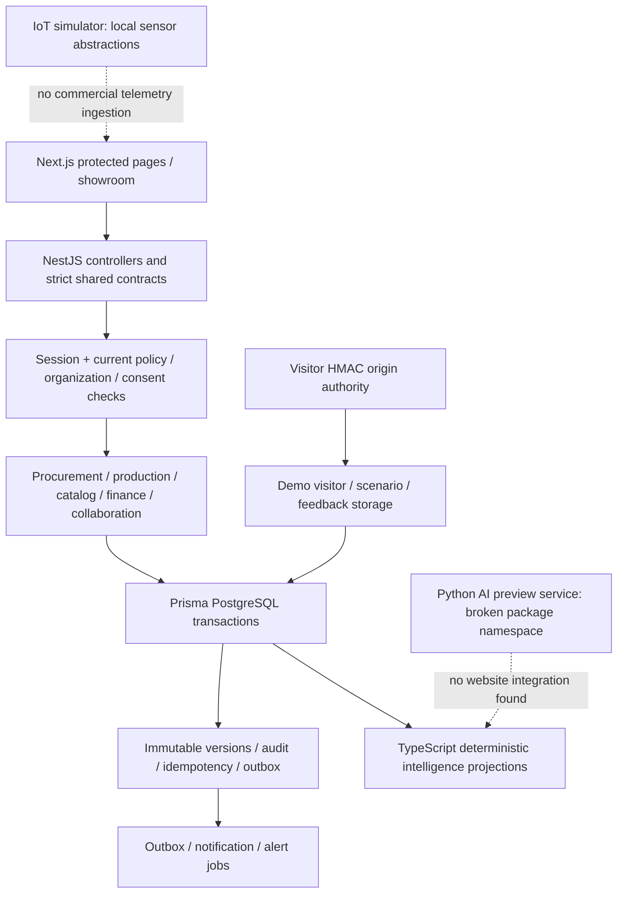

Generated 2026-10-29T21:51:59.262417+00:00. Read-only product/backlog/GitHub audit. Owner acceptance **PENDING**.

**Coverage is incomplete.** The live backlog and exact original criterion registry are complete; this is not a completed deep audit of all source or all acceptance criteria. Structural indexing is not semantic verification. The three independent workstreams stopped at an account usage limit before completing their full assessments; their useful source indexes/probes were retained and root-reviewed before use. Unassessed criteria are explicitly marked `inspectionComplete=false` in the inventory. No percentage of project implementation can defensibly be inferred from the independently verified lower bound. Passing regression totals do not close these gaps.

`IMPLEMENTED_NOT_VERIFIED` is a provisional evidence bucket for related code with the exact criterion not established; it does **not** assert complete implementation. Related source/API/table/test candidates are discovery aids. Only `sourceEvidence` means a direct inspected criterion trace; only `VERIFIED_IMPLEMENTED` earns positive executable acceptance credit. Negative probes are executable contradiction evidence, not positive acceptance. External-gate classifications do not assert that no private external evidence exists.

The application is a Next.js App Router frontend calling an authoritative NestJS API with shared Zod contracts, Prisma and PostgreSQL. The API module graph registers foundation/IAM, organizations, artisans, commerce/procurement, catalog, inventory, finance, collaboration, intelligence, sales, governance, registry and demo. CommerceModule registers planning/execution/finance/logistics providers: these files are not orphaned simply because they lack individual Nest modules.

Authority is checked in resource services, not merely navigation. Accepted commercial work is distinct from editable planning. Monetary values use integer millimes/BigInt or explicit Decimal arithmetic; production and capacity quantities have declared units. Genuine settlement, legal disposition, privacy review and representative outcome evidence remain external gates. This describes inspected architecture, not certification of every implementation path.

| Epic | Subsystem / source entry | Persistence candidates | API boundary | Test discovery candidate |
|---|---|---|---|---|
| E00 | Discovery and external gates: `docs/engineering` | None: external evidence | `None: operational review` | `docs/engineering/BATCH6_ACCEPTANCE_MATRIX.md` |
| E01 | Identity, organizations and artisans: `apps/api/src/modules/organizations/organizations.service.ts` | User; Session; Organization; OrganizationMember; ArtisanProfile | `/api/v1/organizations; /api/v1/artisans` | `apps/api/test/organizations.scenarios.ts` |
| E02 | Buyer procurement: `apps/api/src/modules/procurement/procurement.service.ts` | CommercialRfq; ProcurementRevision; ProcurementSample | `/api/v1/procurement/rfqs` | `apps/api/test/procurement.scenarios.ts` |
| E03 | Feasibility, quotations and contracts: `apps/api/src/modules/procurement/procurement.service.ts` | ProcurementQuote; CommercialOrder | `/api/v1/procurement/rfqs` | `apps/api/test/procurement.scenarios.ts` |
| E04 | Artisan network and capacity: `apps/api/src/modules/artisans/capacity.ts` | CapacityDeclaration; DelegationGrant; CommercialOffer | `/api/v1/artisans; /api/v1/directory` | `apps/api/test/capacity.scenarios.ts` |
| E05 | Allocation and offer planning: `apps/api/src/modules/procurement/planning.ts` | AllocationPlan; AllocationPlanItem; RecommendationSnapshot | `/api/v1/procurement/allocation-plans` | `apps/api/test/planning-intelligence.scenarios.ts` |
| E06 | Production execution and collaboration: `apps/api/src/modules/collaboration/collaboration.service.ts` | ProductionProgressEvent; ProductionException; ScheduleRevision | `/api/v1/collaboration` | `apps/api/test/collaboration.scenarios.ts` |
| E07 | Materials and inventory: `apps/api/src/modules/inventory/inventory.service.ts` | InventoryMovement; MaterialReservation; MaterialHandover | `/api/v1/inventory` | `apps/api/test/inventory.scenarios.ts` |
| E08 | Quality, rework and appeal: `apps/api/src/modules/procurement/execution.ts` | QualityInspectionAttempt; CommercialInspection; ProductionLedgerEvent | `/api/v1/procurement` | `apps/api/test/execution.scenarios.ts` |
| E09 | Logistics, delivery and traceability: `apps/api/src/modules/procurement/logistics.ts` | Shipment; CustodyHandover; BuyerDeliveryConfirmation | `/api/v1/logistics; /api/v1/trace` | `apps/api/test/batch5.ts` |
| E10 | Finance and settlement: `apps/api/src/modules/finance/finance.service.ts` | ArtisanPayable; PayoutRequest; PaymentDispute; OrderClosureAssessment | `/api/v1/finance` | `apps/api/test/finance.scenarios.ts` |
| E11 | Decision intelligence: `apps/api/src/modules/intelligence/intelligence.service.ts` | ForecastSnapshot; RecommendationSnapshot; AuditEvent | `/api/v1/intelligence` | `apps/api/test/planning-intelligence.scenarios.ts` |
| E12 | Optional local wearable simulation: `../iot` | No wearable commercial DB collection | `/simulator (local demonstration)` | `../iot/simulator/package.json` |
| E13 | Outcomes and metrics: `apps/api/src/modules/intelligence/intelligence.service.ts` | ProductionTimeRecord; ReportingPolicy | `/api/v1/intelligence` | `apps/api/test/planning-intelligence.scenarios.ts` |
| E14 | Governance, consent and support: `apps/api/src/modules/governance/governance.service.ts` | ConsentRecord; PrivacyRequest; SupportCase; AuditEvent | `/api/v1/governance; /api/v1/admin` | `apps/api/test/governance.scenarios.ts` |
| E15 | Showroom and feedback: `apps/api/src/modules/demo/demo.service.ts` | DemoVisitor; DemoScenario; DemoFeedback; DemoFeedbackEvent | `/api/v1/demo; /api/v1/admin/demo-feedback` | `apps/api/test/demo.scenarios.ts` |
| E16 | Security and operations: `apps/api/src/app.module.ts` | AuditEvent; CommandOutcome; OutboxEvent | `Global session/resource/security boundaries` | `apps/api/test/integration.ts` |
| E17 | Challenge and operational evidence: `docs/engineering` | External submission/review records | `/presentation; /evidence` | `tests/e2e` |
| E18 | Sales and buyer feedback: `apps/api/src/modules/sales/sales.service.ts` | CommercialProspect; PilotProposalRevision; BuyerOrderFeedback | `/api/v1/sales; /api/v1/collaboration/order-feedback` | `apps/api/test/order-feedback.scenarios.ts` |
| E19 | Training and adoption: `apps/api/src/modules/registry/registry.service.ts` | OnboardingAuthorization; ParticipantConcern | `/api/v1/registry; /participant-support` | `apps/api/test/artisans.integration.ts` |
| E20 | Catalog and specifications: `apps/api/src/modules/catalog/catalog.service.ts` | ProductSpecificationRevision; ProductSampleRequest | `/api/v1/catalog` | `apps/api/test/product-authority.scenarios.ts` |

Every candidate is resolved against the file manifest before reliance. Model groups and test paths are subsystem discovery candidates; per-criterion verified traces identify inspected files. The matrix distinguishes candidates from proof.

Source and infrastructure coverage: `evidence/file-inventory.json` lists all 1,071 pre-existing nonignored website files with hash, byte/line count and category. `source-cross-reference.json` structurally indexes 474 app/package/test/script/workflow source/config files. Additional root configuration and documents are inventoried, not all semantically reviewed. Frontend indexes cover 153 web source files and 27 browser files. Sibling baselines inventory 53 AI and 15 IoT files separately. Dependency trees, generated build artifacts, git internals, ignored caches and binaries are excluded. Existing documentation/evidence is inventoried; only selected relevant architecture, acceptance, planning, verification and progress claims were independently followed into source. No exhaustive documentation-read claim.

Database: 134 Prisma models and 38 SQL migrations are structurally inventoried in `database-inventory.json`; model fields/relations/indexes and migration objects/checks/triggers are recorded. Textual CHECK/trigger counts are not native invariant coverage. The regression upgrades populated databases, validates migration checksums and restores 135 tables (including Prisma history) with 3,320 rows. Historical migrations were not changed. Native B13/B14 guards and targeted financial CHECK were exercised. The remaining models/migrations have **not** all received independent relation-by-relation, race and authority review.

Journeys: organization review, voluntary capacity, privacy-scoped directory, ranking/scenario exploration, intelligence labels, and showroom feedback have bounded direct review. Browser regression covers desktop/mobile workflows and existing axe assertions. The B13 lost-committed-response probe ran on 390/1280px and exposed a retry trap. Missing collaboration creation UI and offer localization show why fixture-backed happy tests are insufficient. No manual assistive-device assessment, every offline lifecycle, hardware test or live deployment verification was performed.

Notifications use explicit jobs/outbox and configured channels; successful local SMTP capture proves local delivery behavior only. Public trace projections and protected route inventories are indexed, not universally penetration-tested. PWA/offline, backup scheduling, host monitoring and operational disaster recovery beyond disposable dump/restore remain unverified at acceptance level. Workflows are present with pinned actions and scoped permissions; local checks are not a claim that GitHub CI or production passed.

Safety/freshness: baseline manifests record heads, git indexes, dirty status and SHA-256 of every existing file in website/docs/AI/IoT repositories. Final preservation evidence compares those exact files and indexes. All API/integration/browser databases were disposable loopback Docker PostgreSQL 17.7 with local SMTP; build/validation use a deliberately unreachable sentinel DB URL. No persistent database, GitHub mutation, canonical backlog edit, product edit, commit or deployment was performed.
